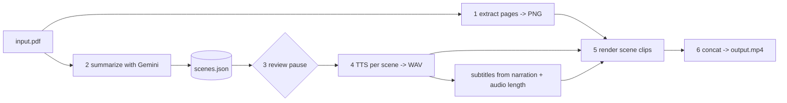

# 01 — pdf2video CLI
Status: in progress · Size: large

## Goal
A Node.js/npm CLI that turns a PDF into a short, narrated, summarized MP4.
`pdf2video report.pdf -o report.mp4`

Gemini summarizes the PDF into scenes. Gemini TTS reads each scene. The video shows the
PDF's own pages (slow zoom/crop onto the part being discussed) with burned-in subtitles.

## Decisions
| # | Decision | Chosen by |
|---|---|---|
| D1 | Output = narrated summary video, not a slideshow and not AI-generated footage | user |
| D2 | AI = Google only: Gemini for the summary, Gemini TTS for the voice. One key, `GOOGLE_AI` env var | user |
| D3 | On screen = the PDF's own pages with zoom/crop + subtitles (option A) | user |
| D4 | Scene format is renderer-neutral (`visual` + `narration`), so generated slides can be added later without a rewrite | leader |
| D5 | Node.js + npm CLI (not Bun) | user |
| D6 | Review step: CLI writes `scenes.json`, pauses so the user can edit, then renders. `--no-review` skips the pause | leader, user approved plan |
| D7 | ffmpeg comes from the `ffmpeg-static` npm package, so `npm install` is enough | user (2026-10-11) |
| D8 | TypeScript, run with `tsx`, built with `tsup`. `commander` for the CLI, `zod` for validation, `vitest` for tests | leader (defaults from global rules) |
| D9 | v1 defaults: English, 90 s target, 1920x1080 landscape (all overridable by flags) | user (2026-10-11) |
| D10 | Local git repo with numbered commits; `.gitignore` is deny-by-default | user (2026-10-11) |
| D11 | Process: one devil review, then straight to T1 (no architect/auditor pass) | user (2026-10-11) |
| D13 | PDF rasteriser default: `pdfjs-dist` + `@napi-rs/canvas` (prebuilt, permissive licences) over `mupdf` WASM (AGPL). T3 may overturn it only for a concrete reason, logged | leader, after devil |
| D14 | Silent scene clips + one joined audio track muxed at the end (devil B2) | leader, after devil |
| D15 | Cache files named by a hash of their inputs; a user-edited `scenes.json` is never overwritten (devil B1) | leader, after devil |
| D16 | Work dir is always kept (it is the cache); `--keep` dropped from the CLI surface | leader |
| D17 | `--scenes <file>` dropped from v1: the review pause and the `render` command cover editing a script | leader, after review |
| D12 | `GOOGLE_AI` assumed to be an AI Studio (Gemini Developer API) key; T1's smoke test confirms | leader |

## Design

### Pipeline


### Scene format (the contract between stages)
```jsonc
{
  "title": "…",
  "language": "en",
  "scenes": [
    {
      "id": 1,
      "page": 3,                        // 1-based PDF page shown
      "focus": { "x": 0.1, "y": 0.2, "w": 0.8, "h": 0.4 }, // optional, 0-1 of the page; omit = whole page
      "narration": "Plain sentences read aloud."
    }
  ]
}
```
Validated with zod. Gemini output is forced into this shape with `responseMimeType: "application/json"` + `responseJsonSchema`.

### Modules (one job each)
```
src/cli.ts                  commander entry: flags, calls the pipeline, prints progress
src/config.ts               flags + env -> typed config (model ids, voice, size, target length)
src/schema.ts               zod schemas: Scenes, Scene, Focus
src/pipeline/extract.ts     PDF -> page PNGs + page count
src/pipeline/summarize.ts   PDF -> Scenes via Gemini (inline <=~20 MB, else Files API)
src/pipeline/tts.ts         narration -> WAV per scene; returns duration from sample count
src/pipeline/subtitles.ts   narration + duration -> SRT/ASS cues
src/pipeline/render.ts      page PNG + audio + subs -> clip; concat clips -> MP4
src/lib/gemini.ts           the only file that imports @google/genai; retry + backoff
src/lib/cache.ts            work-dir cache keyed by content hash (resume, no repeat API cost)
```
Work dir: `./.pdf2video/<pdf-hash>/` holding page PNGs, `scenes.json`, `audio/<hash>.wav`, `clips/<hash>.mp4`.

### Cache keys (devil B1: files are named by a hash of their inputs, never by scene number)
| Output | Key = hash of | Notes |
|---|---|---|
| `pages/NNN.png` | PDF hash + raster DPI/settings | page numbers are stable for one PDF |
| `scenes.json` | PDF hash + summary model + length + lang + prompt version (stored in `scenes.meta.json`) | if the file's current hash differs from the generated hash, the user edited it: **never overwrite**; warn and keep it unless `--force` |
| `audio/<h>.wav` | narration + voice + TTS model + lang | inserting/reordering scenes reuses audio correctly |
| `clips/<h>.mp4` | audio hash + page + focus + size + `RENDER_VERSION` | silent video only (see B2) |
`--force` ignores all of them. Orphaned hashed files are harmless; the work dir is kept (D16) — delete it by hand to reclaim space.

### Gemini facts checked against SDK docs (js-genai v2, Context7)
- Package `@google/genai`. `new GoogleGenAI({ apiKey })`. Read `process.env.GOOGLE_AI` ourselves and pass it in, because the SDK's default variable is not `GOOGLE_AI`.
- PDF input: `inlineData` with `mimeType: "application/pdf"`, or `ai.files.upload` + `createPartFromUri` for big files.
- Structured output: `config.responseMimeType = "application/json"` + `responseJsonSchema`.
- TTS: `config.speechConfig.voiceConfig.prebuiltVoiceConfig.voiceName`, audio comes back as base64 PCM (to be confirmed in task 1: expected 24 kHz, 16-bit, mono).
- **Model ids are not fixed in the plan.** Task 1 looks up the current ids (summary model, TTS model) and puts them in `config.ts` as overridable defaults (`--model`, `--tts-model`).

### CLI surface
```
pdf2video <input.pdf> [options]
  -o, --out <file>        output mp4              (default: <name>.mp4)
  --voice <name>          Gemini prebuilt voice   (default set in task 1)
  --lang <code>           narration language      (default: en)
  --length <seconds>      target video length     (default: 90)
  --size <WxH>            output size             (default: 1920x1080)
  --no-review             do not pause on scenes.json
  --force                 ignore cache
```
Review pause (devil should-fix 8): skipped automatically when stdin is not a TTY; prints the absolute path of `scenes.json`; after Enter it re-validates, and on bad JSON shows the error and pauses again. `--no-review` arrives from commander as `review: false`.

Commands also split for the review flow: `pdf2video plan <pdf>` (stages 1-2, writes scenes.json) and `pdf2video render <pdf>` (stages 3-6). The default command runs both with a pause between.

### Rendering notes
- Page is fitted into 16:9 over a blurred copy of itself, so portrait pages do not leave black bars. Blurred background is made once per page (a still PNG), not per frame.
- Zoom = a slow push toward `focus`. `zoompan` snaps to whole pixels and shakes, so upscale the still ~4x first (or crop+scale with float expressions). Input is one still frame with a fixed frame count, not `-loop 1`.
- Scene duration = audio length + 0.4 s tail.
- **Audio/video join (devil B2):** scene clips are rendered **silent** and joined with the concat demuxer. The WAVs (each padded with 0.4 s silence) are joined into **one** audio track and muxed once at the end. This avoids AAC priming clicks and drift at clip boundaries.
- Subtitles: one ASS file for the whole video (cue times = running sum of scene durations), `PlayResX/Y` = `--size`. Burned in during the final mux. Run ffmpeg with `cwd` = work dir and a relative file name (Windows `C:\` breaks filter strings). Ship a font file and pass `fontsdir=`. Fallback: soft `.srt` beside the mp4.
- Always `spawn` ffmpeg with an argument array, never through a shell.
- `ffmpeg-static` has no ffprobe: durations come from WAV sample counts; checks use `ffmpeg -i`.

### Validation (devil should-fix 7)
- `page` is the 1-based **position in the file**, not the printed page number (prompt and schema say so).
- zod checks shape; a second runtime check uses the real page count: page out of range → clamp + warn; focus with `x+w>1` or `y+h>1` → drop focus + warn.

### Gemini limits (devil should-fix 1, 2, 9)
- Free-tier TTS quota may be only a few requests per minute and tens per day. Cap scenes at ~8 for 90 s (roughly `length / 11`). A 429 that names a **daily** quota stops the run with "resume later" (progress is cached), it is not retried.
- TTS reply with no audio, or audio shorter than ~0.3 s per word → treat as failure and retry.
- PDF inline only up to ~14 MB raw (base64 grows it past the 20 MB request limit); above that, use the Files API.

## Acceptance
- [ ] `pdf2video sample.pdf` (10-page text PDF) produces an MP4 that plays, with voice, matching subtitles, and roughly the `--length` asked for (±30%)
- [ ] Every scene's page number exists in the PDF (bad page from Gemini is rejected or clamped, not crashed on)
- [ ] Editing `scenes.json` during the review pause changes the final video (text, page and focus)
- [ ] Re-run with no changes makes zero API calls and finishes in seconds (cache)
- [ ] Changing one scene's narration re-does only that scene's TTS + clip
- [ ] Missing `GOOGLE_AI` -> clear message naming the variable, exit code 1, no stack trace, key never printed
- [ ] Scanned/image-only PDF still works (Gemini reads the page images)
- [ ] 1-page PDF, 100+ page PDF (summary stays within `--length`), password-protected PDF (clean error), non-PDF file (clean error)
- [ ] API errors: 429 rate limit retries with backoff then fails with a clear message; partial progress is kept for resume
- [ ] Portrait and landscape pages both look right in 16:9
- [ ] Works on Windows from PowerShell with `npm install` only (no manual ffmpeg install)
- [ ] First run prints a one-line notice that the PDF content is sent to Google; `--yes` silences it

## Tasks
Run one task per coder run. `owns:` files must not overlap between parallel runs.

- [x] **T1 Scaffold + Gemini smoke test** — owns: `package.json`, `tsconfig.json`, `tsup.config.ts`, `src/lib/gemini.ts`, `src/config.ts`, `scripts/smoke.ts` — done when: `npx tsx scripts/smoke.ts` gets a JSON reply for a tiny PDF and a playable WAV from TTS; current model ids, the PCM format, the TTS quota seen in AI Studio, and whether `ffmpeg -filters` lists `subtitles` are written into this plan's Log
- [x] **T2 Schema + cache** — owns: `src/schema.ts`, `src/lib/cache.ts`, tests — done when: zod rejects bad scenes (page 0, focus outside 0-1, empty narration); cache hit/miss unit tests pass, including: edited narration → new audio key; inserted scene → other scenes keep their keys; edited `scenes.json` is not overwritten; runtime page clamp / focus drop
- [x] **T3 Extract pages** — owns: `src/pipeline/extract.ts` — done when: a 10-page PDF gives 10 PNGs at a sane size; encrypted PDF gives a clean error. Uses D13 unless a concrete problem is found (log it)
- [x] **T4 Summarize** — owns: `src/pipeline/summarize.ts`, prompt file — done when: sample PDF returns valid Scenes within `--length` budget (words ≈ seconds × 2.5); invalid output triggers one repair retry; scene count capped (~length/11); page = file position; >14 MB uses Files API
- [x] **T5 TTS** — owns: `src/pipeline/tts.ts` — done when: each scene gets a WAV with correct duration; 429 per-minute retried, daily quota stops cleanly; empty/short audio retried; cached by hash
- [x] **T6 Subtitles** — owns: `src/pipeline/subtitles.ts`, tests — done when: one ASS for the whole video; cues cover each scene's duration with no gaps/overlaps; no line over ~42 chars; PlayRes = `--size`
- [x] **T7 Render** — owns: `src/pipeline/render.ts` — done when: silent clip per scene with smooth zoom; concat + one audio track + burned subs gives one MP4; duration (via `ffmpeg -i`) ≈ sum of padded audio, A/V in sync at the last scene
- [x] **T8 CLI + review flow** — owns: `src/cli.ts` — done when: `plan`, `render`, and the default command with pause all work; error messages match Acceptance
- [ ] **T9 End-to-end + README** — owns: `README.md`, `test/e2e/*` — done when: all Acceptance items tick on Windows

Order: T1 -> (T2, T3 in parallel) -> T4, T5, T6 (parallel, different files) -> T7 -> T8 -> T9.

## Risks (leader first pass + devil review 2026-10-11; blockers B1, B2 resolved in Design)
- **Gemini TTS rate limits / preview models.** Free-tier quotas are small and preview model names change. Mitigation: configurable model ids, backoff, per-scene cache.
- **Focus boxes from Gemini may be wrong** (it is guessing coordinates). Mitigation: focus is optional; fall back to whole page; user can edit in review. Check accuracy in T4 and drop the feature if it is poor.
- **Summary accuracy.** Narration could state things the PDF does not say. Mitigation: prompt says "only claims in the document"; the review pause exists for this.
- **Privacy.** PDF content leaves the machine (user chose Google, D2). Mitigation: first-run notice; never log PDF text or the key.
- **ffmpeg-static may lack libass** (subtitle burn-in). Mitigation: T1 checks `ffmpeg -filters`; fall back to soft subs, or draw subs as PNG overlays. Fontconfig may pick a random font: ship a font, pass `fontsdir=`.
- **Free-tier TTS quota may allow ~1 full run per day** (devil). Mitigation: scene cap, per-scene cache, daily-quota stop, mocked TTS in unit tests; T9 may need several days or a paid tier.
- **Cache staleness** (devil B1). Resolved: input-hash file names (D15).
- **A/V drift at clip joins** (devil B2). Resolved: D14.
- **`GOOGLE_AI` not visible in already-running shells.** Resolved: commands load it from the user environment (see CLAUDE.md).
- **Long PDFs.** Large inline size and token limits. Mitigation: Files API above ~20 MB; for very long docs, summarize in chunks then merge (out of scope for v1 unless T4 shows it is needed).

## Open questions
- None blocking. D12 is confirmed or overturned by T1.

## Log
- 2026-10-11 — plan drafted from the brainstorm (user: summarized video, Google AI, PDF pages on screen, Node/npm CLI). D6 and D7 assumed, not yet confirmed.
- 2026-10-11 — user answered open questions (D7, D9-D11); plan approved; git initialised. `GOOGLE_AI` confirmed at Windows user level (not in already-running shells).
- 2026-10-11 — devil review merged: B1 → cache keys table + D15; B2 → silent clips + single audio track (D14); D13 rasteriser default; validation, Gemini limits, review-pause rules added; T2–T7 done-when tightened.
- 2026-10-11 — T1 done: models `gemini-3.8-flash` (summary) + `gemini-3.8-flash-tts`, voice Kore (from ai.google.dev/gemini-api/docs/models). TTS returns a **complete WAV** (24 kHz mono s16), unwrapped by `src/lib/wav.ts`. D12 confirmed (AI Studio key). ffmpeg-static 6.1.1 has `subtitles` + `ass`. Daily 429 → QuotaExhaustedError. TTS quota not yet read from AI Studio.
- 2026-10-11 — T2 done: zod schemas + `z.toJSONSchema` for Gemini; hashed cache keys; scenes.json without readable meta counts as user-edited. 17 tests pass.
- 2026-10-11 — user asked: finish AI integration as MVP (T4 summarize + T5 TTS + thin `plan` CLI), then push repo public to GitHub (gh to be installed by user; commits to use GitHub noreply email).
- 2026-10-11 — T4 done: real API on 4-page fixture → 3 scenes, 75/75 words, no warnings. Follow-ups: Files API for >14 MB (TODO in summarize.ts, needs gemini.ts); `package.json` `files` must include `prompts/` before npm publish; focus accuracy still unchecked.
- 2026-10-11 — T5 done: sequential cached TTS, short-audio retry, joinNarration with 0.4 s tails + timings. Tried a style prefix ("Read in a calm… tone:") — fails because gemini-3.8-flash-tts reads it aloud (A/B 3.48 s vs 7.48 s); removed, TTS_PROMPT_VERSION=2.
- 2026-10-11 — MVP slice of T8 done (AI stages only): `plan`, `voice`, default command with review pause, first-run notice, clean errors; `pdfinfo.ts` uses pdfjs-dist (D13). Real run: sample.pdf → 3 scenes → narration.wav 40.9 s. **Free-tier TTS quota is 10 requests/day** on gemini-3.8-flash-tts — hit during the cache re-run check; zero-call re-run still to confirm after reset. T8 stays open until render is wired in.
- 2026-10-11 — T3 done: pdfjs-dist + @napi-rs/canvas (D13 holds). Pages render at 2160 px high (long side ≤ 4096), ~0.3 s/page, cached per settings hash. Encrypted-PDF error tested by mock only (no cheap encrypted fixture).
- 2026-10-11 — T6 done: one ASS (BorderStyle 3 box, size h/22) + SRT fallback; ≤2 lines × 42 chars; cues contiguous within each scene's speech, none in the 0.4 s tails. `assets/` allowed in .gitignore for T7's font.
- 2026-10-11 — T7 done: tried zoompan on a 2x stage — fails because it snaps to whole pixels (every ~3rd frame identical); now each frame is drawn with @napi-rs/canvas at fractional offsets and piped to ffmpeg as raw RGBA. 1080p, 3 scenes / 40.9 s: 35 s first render, 8 s cached; duration matches narration within 0.01 s. Font: Noto Sans (OFL) in assets/fonts. Leader frame check found 2 bugs from earlier tasks: standard PDF fonts render in a wrong narrow system font (T3), subtitle box low-contrast on white with a darker overlap band (T6).
- 2026-10-11 — T8 done: `render` command; default command now plan → review → voice → render; `-o`, `--size` (validated before API calls); D16 (no `--keep`). Subtitle box made ~92% opaque (`&H14`) — no overlap band, readable on white. Mocked end-to-end test renders a 320x180 MP4. 71 tests.
- 2026-10-11 — Font bug fixed: tried useSystemFonts/disableFontFace — no effect; real cause: pdfjs's Node loader passes `file://` URL strings to fs.readFile, so standard fonts (and cMaps/ICC/wasm) never loaded. Now plain paths with a trailing `/`; RASTER_VERSION=2; dark-pixel regression test. Leader confirmed page 2 visually. Open: embedded-font PDF not tested; real end-to-end TTS run waits for quota reset.
- 2026-10-11 — First full code review: 2 blockers (half-written clips/WAVs/PNGs reused as cache; stage/clip keys ignore page raster so the font fix never reached old work dirs), should-fix: --size checked after an API call, subtitles matched by non-unique scene id, TTS no-audio retried up to 15×, `--scenes` missing (→ D17). Fixes in progress.
- 2026-10-11 — Review fixes landed (0015, 0016); re-review: all findings fixed. Open: retry rename on Windows EPERM/EBUSY (file open in a player / antivirus), askOrCancel listener leak, prevFileHash restore edge case.
- 2026-10-11 — Last review items fixed (0017): rename retried on EPERM/EACCES/EBUSY ~2 s, then the finished temp is kept with a clear message; askOrCancel removes its listeners; prevFileHash cleared after write. 92 tests. Remaining: T9 real end-to-end after TTS quota reset.
