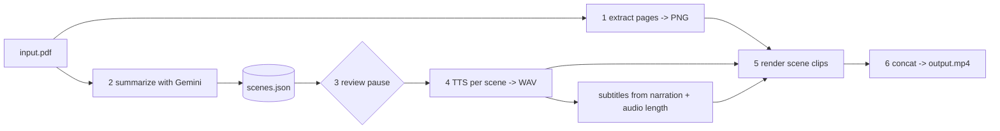

# 01 — pdf2video CLI
Status: approved · Size: large

## Goal
A Node.js/npm CLI that turns a PDF into a short, narrated, summarized MP4.
`pdf2video report.pdf -o report.mp4`

Gemini summarizes the PDF into scenes. Gemini TTS reads each scene. The video shows the
PDF's own pages (slow zoom/crop onto the part being discussed) with burned-in subtitles.

## Decisions
| # | Decision | Chosen by |
|---|---|---|
| D1 | Output = narrated summary video, not a slideshow and not AI-generated footage | user |
| D2 | AI = Google only: Gemini for the summary, Gemini TTS for the voice. One key, `GOOGLE_AI` env var | user |
| D3 | On screen = the PDF's own pages with zoom/crop + subtitles (option A) | user |
| D4 | Scene format is renderer-neutral (`visual` + `narration`), so generated slides can be added later without a rewrite | leader |
| D5 | Node.js + npm CLI (not Bun) | user |
| D6 | Review step: CLI writes `scenes.json`, pauses so the user can edit, then renders. `--no-review` skips the pause | leader, user approved plan |
| D7 | ffmpeg comes from the `ffmpeg-static` npm package, so `npm install` is enough | user (2026-10-11) |
| D8 | TypeScript, run with `tsx`, built with `tsup`. `commander` for the CLI, `zod` for validation, `vitest` for tests | leader (defaults from global rules) |
| D9 | v1 defaults: English, 90 s target, 1920x1080 landscape (all overridable by flags) | user (2026-10-11) |
| D10 | Local git repo with numbered commits; `.gitignore` is deny-by-default | user (2026-10-11) |
| D11 | Process: one devil review, then straight to T1 (no architect/auditor pass) | user (2026-10-11) |
| D12 | `GOOGLE_AI` assumed to be an AI Studio (Gemini Developer API) key; T1's smoke test confirms | leader |

## Design

### Pipeline


### Scene format (the contract between stages)
```jsonc
{
  "title": "…",
  "language": "en",
  "scenes": [
    {
      "id": 1,
      "page": 3,                        // 1-based PDF page shown
      "focus": { "x": 0.1, "y": 0.2, "w": 0.8, "h": 0.4 }, // optional, 0-1 of the page; omit = whole page
      "narration": "Plain sentences read aloud."
    }
  ]
}
```
Validated with zod. Gemini output is forced into this shape with `responseMimeType: "application/json"` + `responseJsonSchema`.

### Modules (one job each)
```
src/cli.ts                  commander entry: flags, calls the pipeline, prints progress
src/config.ts               flags + env -> typed config (model ids, voice, size, target length)
src/schema.ts               zod schemas: Scenes, Scene, Focus
src/pipeline/extract.ts     PDF -> page PNGs + page count
src/pipeline/summarize.ts   PDF -> Scenes via Gemini (inline <=~20 MB, else Files API)
src/pipeline/tts.ts         narration -> WAV per scene; returns duration from sample count
src/pipeline/subtitles.ts   narration + duration -> SRT/ASS cues
src/pipeline/render.ts      page PNG + audio + subs -> clip; concat clips -> MP4
src/lib/gemini.ts           the only file that imports @google/genai; retry + backoff
src/lib/cache.ts            work-dir cache keyed by content hash (resume, no repeat API cost)
```
Work dir: `./.pdf2video/<pdf-hash>/` holding page PNGs, `scenes.json`, `audio/NN.wav`, `clips/NN.mp4`.
Re-running skips any stage whose output already exists (`--force` to redo).

### Gemini facts checked against SDK docs (js-genai v2, Context7)
- Package `@google/genai`. `new GoogleGenAI({ apiKey })`. Read `process.env.GOOGLE_AI` ourselves and pass it in, because the SDK's default variable is not `GOOGLE_AI`.
- PDF input: `inlineData` with `mimeType: "application/pdf"`, or `ai.files.upload` + `createPartFromUri` for big files.
- Structured output: `config.responseMimeType = "application/json"` + `responseJsonSchema`.
- TTS: `config.speechConfig.voiceConfig.prebuiltVoiceConfig.voiceName`, audio comes back as base64 PCM (to be confirmed in task 1: expected 24 kHz, 16-bit, mono).
- **Model ids are not fixed in the plan.** Task 1 looks up the current ids (summary model, TTS model) and puts them in `config.ts` as overridable defaults (`--model`, `--tts-model`).

### CLI surface
```
pdf2video <input.pdf> [options]
  -o, --out <file>        output mp4              (default: <name>.mp4)
  --voice <name>          Gemini prebuilt voice   (default set in task 1)
  --lang <code>           narration language      (default: en)
  --length <seconds>      target video length     (default: 90)
  --size <WxH>            output size             (default: 1920x1080)
  --no-review             do not pause on scenes.json
  --scenes <file>         skip summarize, use this scenes.json
  --force                 ignore cache
  --keep                  keep the work dir
```
Commands also split for the review flow: `pdf2video plan <pdf>` (stages 1-2, writes scenes.json) and `pdf2video render <pdf>` (stages 3-6). The default command runs both with a pause between.

### Rendering notes
- Page is fitted into 16:9 over a blurred copy of itself, so portrait pages do not leave black bars.
- Zoom = a slow push toward `focus` (ffmpeg `zoompan`, or crop + scale). Duration = audio length + 0.4 s tail.
- Subtitles: split narration into sentences, share the scene's audio duration by character count. Burn in (needs libass, checked in task 4) or fall back to a soft `.srt` beside the mp4.
- Clips are rendered per scene then joined with the concat demuxer, so one changed scene means one re-render.

## Acceptance
- [ ] `pdf2video sample.pdf` (10-page text PDF) produces an MP4 that plays, with voice, matching subtitles, and roughly the `--length` asked for (±30%)
- [ ] Every scene's page number exists in the PDF (bad page from Gemini is rejected or clamped, not crashed on)
- [ ] Editing `scenes.json` during the review pause changes the final video (text, page and focus)
- [ ] Re-run with no changes makes zero API calls and finishes in seconds (cache)
- [ ] Changing one scene's narration re-does only that scene's TTS + clip
- [ ] Missing `GOOGLE_AI` -> clear message naming the variable, exit code 1, no stack trace, key never printed
- [ ] Scanned/image-only PDF still works (Gemini reads the page images)
- [ ] 1-page PDF, 100+ page PDF (summary stays within `--length`), password-protected PDF (clean error), non-PDF file (clean error)
- [ ] API errors: 429 rate limit retries with backoff then fails with a clear message; partial progress is kept for resume
- [ ] Portrait and landscape pages both look right in 16:9
- [ ] Works on Windows from PowerShell with `npm install` only (no manual ffmpeg install)
- [ ] First run prints a one-line notice that the PDF content is sent to Google; `--yes` silences it

## Tasks
Run one task per coder run. `owns:` files must not overlap between parallel runs.

- [ ] **T1 Scaffold + Gemini smoke test** — owns: `package.json`, `tsconfig.json`, `tsup.config.ts`, `src/lib/gemini.ts`, `src/config.ts`, `scripts/smoke.ts` — done when: `npx tsx scripts/smoke.ts` gets a JSON reply for a tiny PDF and a playable WAV from TTS; current model ids and the PCM format are written into this plan's Log
- [ ] **T2 Schema + cache** — owns: `src/schema.ts`, `src/lib/cache.ts`, tests — done when: zod rejects bad scenes (page 0, focus outside 0-1, empty narration); cache hit/miss unit tests pass
- [ ] **T3 Extract pages** — owns: `src/pipeline/extract.ts` — done when: a 10-page PDF gives 10 PNGs at a sane size; encrypted PDF gives a clean error. Library choice (candidate: `mupdf` WASM, no native build) is decided here and logged
- [ ] **T4 Summarize** — owns: `src/pipeline/summarize.ts`, prompt file — done when: sample PDF returns valid Scenes within `--length` budget (words ≈ seconds × 2.5); invalid output triggers one repair retry
- [ ] **T5 TTS** — owns: `src/pipeline/tts.ts` — done when: each scene gets a WAV with correct duration; 429 handled; cached
- [ ] **T6 Subtitles** — owns: `src/pipeline/subtitles.ts`, tests — done when: cues cover the audio duration with no gaps/overlaps and no line over ~42 chars
- [ ] **T7 Render** — owns: `src/pipeline/render.ts` — done when: one scene -> clip with zoom + subs + audio; concat gives one MP4; `ffprobe` duration ≈ sum of audio
- [ ] **T8 CLI + review flow** — owns: `src/cli.ts` — done when: `plan`, `render`, and the default command with pause all work; error messages match Acceptance
- [ ] **T9 End-to-end + README** — owns: `README.md`, `test/e2e/*` — done when: all Acceptance items tick on Windows

Order: T1 -> (T2, T3 in parallel) -> T4, T5, T6 (parallel, different files) -> T7 -> T8 -> T9.

## Risks (first pass by leader; **devil review still to run**)
- **Gemini TTS rate limits / preview models.** Free-tier quotas are small and preview model names change. Mitigation: configurable model ids, backoff, per-scene cache.
- **Focus boxes from Gemini may be wrong** (it is guessing coordinates). Mitigation: focus is optional; fall back to whole page; user can edit in review. Check accuracy in T4 and drop the feature if it is poor.
- **Summary accuracy.** Narration could state things the PDF does not say. Mitigation: prompt says "only claims in the document"; the review pause exists for this.
- **Privacy.** PDF content leaves the machine (user chose Google, D2). Mitigation: first-run notice; never log PDF text or the key.
- **ffmpeg-static may lack libass** (subtitle burn-in). Mitigation: checked in T7; fall back to soft subs, or draw subs as PNG overlays.
- **`GOOGLE_AI` not visible in the current session.** It is set at user level but this session started earlier. Restart the terminal / Claude Code before T1.
- **Long PDFs.** Large inline size and token limits. Mitigation: Files API above ~20 MB; for very long docs, summarize in chunks then merge (out of scope for v1 unless T4 shows it is needed).

## Open questions
- None blocking. D12 is confirmed or overturned by T1.

## Log
- 2026-10-11 — plan drafted from the brainstorm (user: summarized video, Google AI, PDF pages on screen, Node/npm CLI). D6 and D7 assumed, not yet confirmed.
- 2026-10-11 — user answered open questions (D7, D9-D11); plan approved; git initialised. `GOOGLE_AI` confirmed at Windows user level (not in already-running shells).
